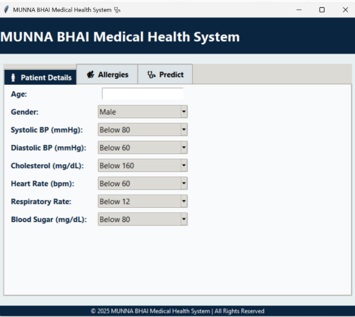
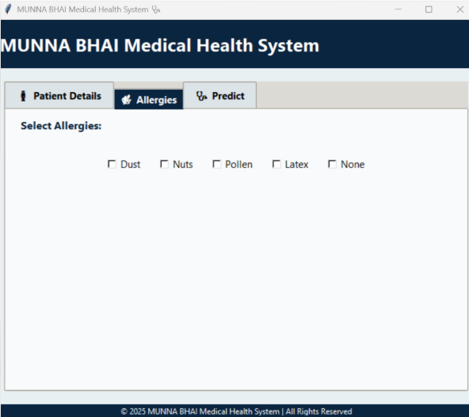
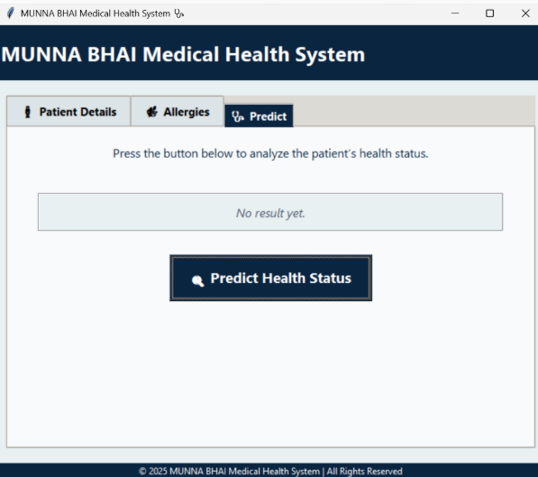
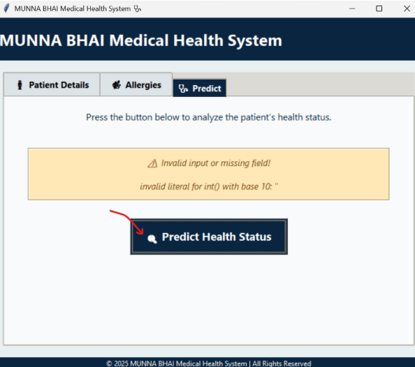
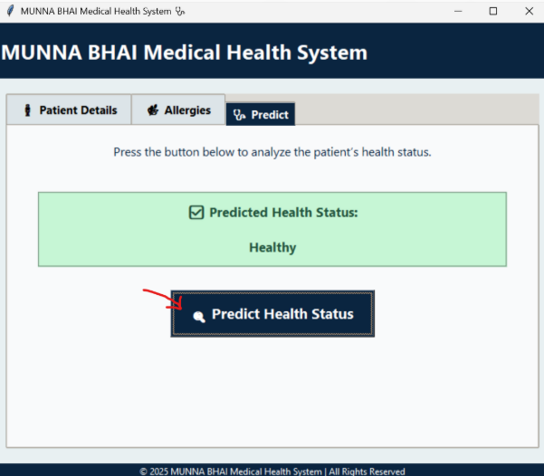
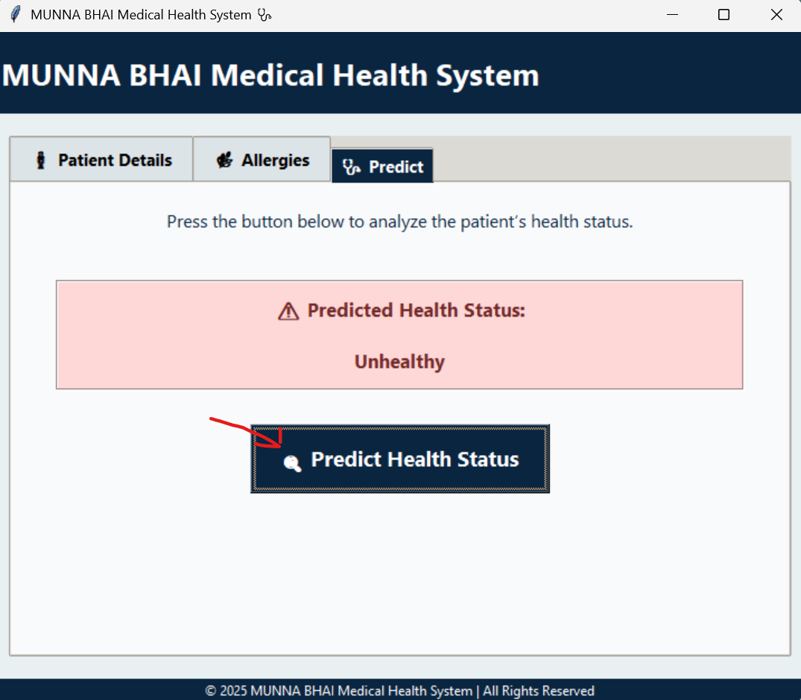

## Application Screenshots

The following screenshots demonstrate the graphical interface and key features of the Health Prediction System.

### 1. Patient Details

The main interface allows users to enter patient information, including age, gender, blood pressure, cholesterol, heart rate, respiratory rate, and blood sugar levels.

### 2. Allergy Selection

Users can select relevant allergies, including dust, nuts, pollen, and latex, or indicate that they have no known allergies.ho

### 3. Prediction Interface

The prediction tab allows users to analyze the entered health indicators using the machine learning model.

### 4. Input Validation

The application displays a warning when required information is missing or an invalid value is entered.

### 5. Healthy Prediction

When the model predicts a healthy status, the result is displayed in green for easy identification.

### 6. Unhealthy Prediction

When the model predicts an unhealthy status, the result is highlighted in red to indicate potential health concerns.

